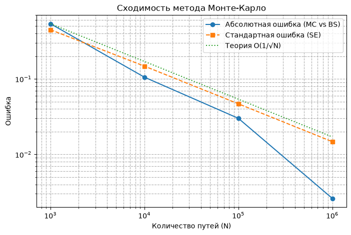

# Monte Carlo Option Pricing & Variance Reduction
[🇬🇧 English](#english) | [🇷🇺 Русский](#russian)

---

<a name="english"></a>
## 🇬🇧 English

### Overview
This project implements a Monte Carlo pricing engine for European options under the Geometric Brownian Motion (GBM) model. It validates the numerical results against the analytical Black-Scholes formula and explores variance reduction techniques to improve simulation efficiency.

### Key Questions
1. Does the Monte Carlo method converge to the Black-Scholes price at the theoretical \(O(1/\sqrt{N})\) rate?
2. How much do variance reduction methods (Antithetic Variates and Control Variates) decrease the standard error for a fixed number of paths?

### Methodology
*   **Simulation**: Risk-neutral GBM for the underlying asset.
*   **Benchmark**: Analytical Black-Scholes formula.
*   **Parameters**: \(S_0=100\), \(K=100\), \(T=1\), \(r=5\%\), \(\sigma=20\%\).

### Results
**1. Convergence (Log-Log Scale)**
The simulation confirms the theoretical convergence rate of \(O(1/\sqrt{N})\). The error decreases by a factor of ~3.16 when the number of paths increases by 10.
*(You can insert your graph here later)*
<!--  -->

**2. Variance Reduction (at \(N=100,000\))**
| Method | Price | Standard Error (SE) | Speedup (Variance Reduction) |
| :--- | :--- | :--- | :--- |
| Plain Monte Carlo | ~10.45 | `SE_plain` | 1.0x |
| Antithetic Variates | ~10.45 | `SE_anti` | ~1.8x |
| Control Variates | ~10.45 | `SE_cv` | ~3.5x |

*(Note: Replace the placeholder values with your exact numbers from the notebook)*

### Project Structure
```text
mc-options/
├── src/
│   ├── black_scholes.py       # Analytical benchmark
│   ├── mc_pricer.py           # Plain Monte Carlo engine
│   └── variance_reduction.py  # Antithetic & Control Variates
├── notebooks/
│   └── research.ipynb         # Experiments and visualizations
└── tests/                     # Pytest validation suite
How to Run
Install dependencies: pip install -r requirements.txt

Run tests: pytest -v

How to Run
Install dependencies: pip install -r requirements.txt

Run tests: pytest -v

Open the research notebook: notebooks/research.ipynb

Limitations
GBM does not account for the volatility smile or fat tails (jumps).

Transaction costs and discrete hedging are not modeled.

Greeks estimation via finite differences can be noisy.

<a name="russian"></a>

🇷🇺 Русский
Описание
Этот проект представляет собой движок для оценки цен европейских опционов методом Монте-Карло в рамках модели геометрического броуновского движения (GBM). Численные результаты валидируются с помощью аналитической формулы Блэка-Шоулза, а также исследуется применение методов снижения дисперсии для повышения эффективности симуляции.

Ключевые вопросы

Сходится ли метод Монте-Карло к цене Блэка-Шоулза с теоретической скоростью O(1/sqrt(N))

Насколько методы снижения дисперсии (Антитетические переменные и Контрольные вариаты) уменьшают стандартную ошибку при фиксированном числе путей?


Методология
Симуляция: GBM в риск-нейтральной мере.

Бенчмарк: Аналитическая формула Блэка-Шоулза.

Параметры: S0=100, K = 100, T=1, r=5%, σ=20%

1. Сходимость (Log-Log масштаб)
Симуляция подтверждает теоретическую скорость сходимости O(1/sqrt(N)). При увеличении количества путей в 10 раз ошибка уменьшается примерно в 3.16 раза.

mc-options/
├── src/
│   ├── black_scholes.py       # Аналитический бенчмарк
│   ├── mc_pricer.py           # Базовый Монте-Карло
│   └── variance_reduction.py  # Антитетика и Контрольные вариаты
├── notebooks/
│   └── research.ipynb         # Эксперименты и графики
└── tests/                     # Тесты (Pytest)

Как запустить
Установите зависимости: pip install -r requirements.txt

Запустите тесты: pytest -v

Откройте ноутбук с исследованием: notebooks/research.ipynb


Ограничения
Модель GBM не учитывает волатильностный смайл и «тяжелые хвосты» (скачки).

Не учитываются транзакционные издержки и дискретное хеджирование.

Оценка греков (Greeks) через конечные разности может быть зашумленной.

